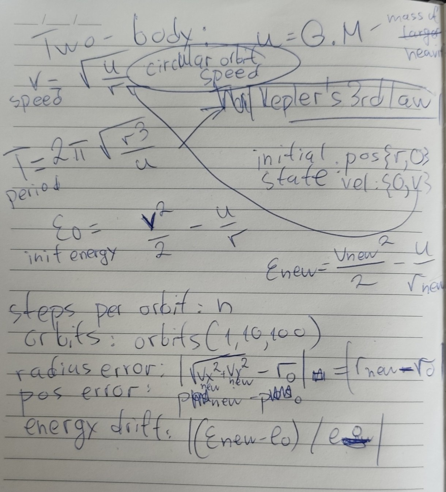
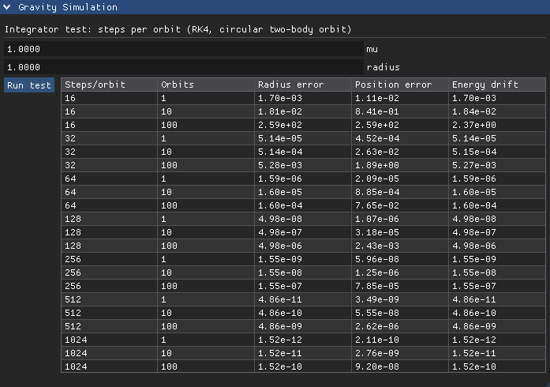
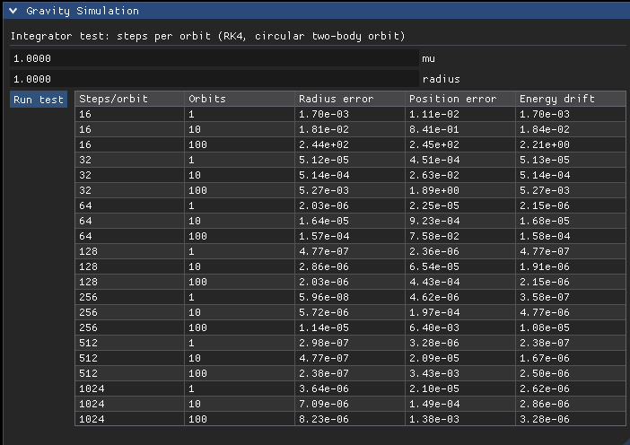

# GravityResearch
An accurate atrophysics simulation of gravitational interactions between stellar objects: Gravity Assists, Lagrange Points, Three-Body-Problem. 

# The classis Three-Body problem is unsolvable; it is mathematically chaotic.
This is unless we make certain assumptions about the system that we would invoke so we CAN solve it:
1.	A small third object with negligible mass around bigger 2 with similar masses
2.	Restrict initial positions/shape so that with every iteration the system stays self-similar
3.	Like the first one, the 2 big objects orbit their common centre of mass in a perfect circle (not ellipse) which makes the Lagrange points fixed/predictable
4.	Planar restriction – assume all motion happens in a single plane by ignoring inclination/out-of-plane motion
5.	Tight pair (two bodies close together, orbiting each other) plus a third one very far away which exerts a small perturbation. Splits the problem into two separate two-body problems.
6.	One gravitational pull dominates and the others are small corrections.

Combining number 1, 3, 4 makes the Planar Circular Restricted Three-Body Problem (PCR3BP). This is what gives us clean 5 Lagrange points.
______________________________________________________________


A look into Gravity Assists

# Research Log

## 31.10.26 (Noon)

### Researching about what and why is RK4

**Reading:** <https://www.math.purdue.edu/~chenjk/MA303S26/%282.6%29%20JC1-acc.html>

**Understanding:**

RK4

$$y_{n+1} = y_n + \frac{h}{6}\left(k_1 + 2k_2 + 2k_3 + k_4\right)$$

is a numerical method for solving the initial value problem – "given the starting state, find y over time" of the form f(t,y) advancing the solution in time intervals of h. In each step it evaluates the rate of change 4 times and combines them into a weighted average which improves accuracy and stability over Euler's solution as it gives calculations with way less errors.

### Setting up project with my 2D Game Engine. The simulation needs to solve a differential equation needs to work in small time steps of size h, using the current state (position and velocity) to get the next state.

**Understanding:**

From the RK4 research I learned that simply using Euler's method would add up errors since the accuracy of the next state is way lower than RK4's method. This means that I will need to somehow implement the RK4 new state calculations in my simulation.

### Thinking of the problem with precision errors for positions, velocities, time in regard to big stellar objects that would need it. ge::Transform puts objects on screen so there is no need to change its float values. However, the physical state needs the double precision.

**Understanding:**

Never store physical state in Transform. Keep it in double on the physics-side and write a float copy to Transform to visualize it.

### As mentioned above h is the time step which needs to be a fixed constant in NONDIMENSIONAL time units.

**Understanding:**

This means that h needs to be separated from frame rate and playback speed => fixed delta time does not work.

### Started implementing Physics Core step applying the RK4 formula in code.

The actual F(y) from which the derivative is later returned is different for both TwoBody and PCR3BP models.

```
Y  = (x, y, vx, vy)
Y' = (vx, vy, ax, ay)
```

**Going through:** <https://mitocw.ups.edu.ec/courses/aeronautics-and-astronautics/16-346-astrodynamics-fall-2008/lecture-notes/lec_01.pdf>

**Understanding:**

Two-body F(y)

```
( vx, vy, −μ_E·x/r³, −μ_E·y/r³ )
```

where μ_E is the gravitational parameter: μ_E = G * M

PCR3BP F(y)

```
( vx, vy,
  2vy + x − (1−μ)(x+μ)/r₁³ − μ(x−1+μ)/r₂³,
  −2vx + y − (1−μ)y/r₁³ − μy/r₂³ )
```

where μ is the secondary body's share of the total mass: μ = m₂ / (m₁ + m₂)

## 31.10.26 (Evening)

**Reading:** <https://www.ross.aoe.vt.edu/books/Ross_3BodyProblem_Book_2022.pdf>

## 02.11.26 (Noon)

### Setting up the Simulation Component important state calculation for a specific model (starting with TwoBody of course).

### Adapting the game engine: Creating a zooming Camera from engine – ZoomAt method on Camera, render correctly with zoom and render scale in Renderer, CameraZoomComponent

## 02.11.26 (Evening)

### Finished up Camera zooming and bound input to mouse scroll – this is now the only part of the engine's input not done via a Command but rather with SDL events and ImGui.

### Researching defaults for the Simulation Component - TwoBody.

**Questions:**

- What is starting Mu?
- What is initial State (position + velocity) of spacecraft?
- What is time scale?
- What is H (time interval)?
- What are the MaxSubsteps ()?

**Understanding:**

- Mu in TwoBody is G * M where G is the gravitational constant and M is the mass of the central body. For the case of testing mu will be 1.
- Initial State can be set explicitly from constructor but for the case of testing: position (1, 0); velocity (0, 1).

  *With mu = 1 and Initial State being 1,0,0,1 the trajectory is a perfect circle which means constant velocity as it is at the same distance from central body at all times.*

- Time scale is 1 by default of course. However, it will be changed via ImGui.
- With the engine's fixed delta being 0.02, the simulation substeps needed per tick are 0.02 * TimeScale / h. A rule of thumb I found online mentions that I would need 200 to 500 steps per orbital period. h being 0.0001 means that at default TimeScale = 1, there will be 0.02 / 0.0001 = 200 steps.
- Max Substeps cap the total amount of simulation steps per Engine Tick. When reached a message can be displayed in the future "Maximum speed reached".


**Result:**

*A satellite with an initial state State the central body "Earth" using the TwoBody model with a given mu. If the position X and the mu match the orbit is a perfect circle like on the image.*

*If values are changed in a specific way, the satellite may either fly away, orbit in an ellipse or orbit in perfect circle.*

## 05.11.26 (Evening)

Started creating celestial bodies component with mass as member which is later accessed for the mu value in a model.

**Result:**

Scrapped the idea for now because of more pressing matters with the simulation steps and time interval situation but came out with needed initial values for such a component: State, mass.

## 06.11.26 (Noon)

### Reading about Jacobi constant

<https://farside.ph.utexas.edu/teaching/celestial/Celestial/node81.html>

**Understanding:**

Only the Three-body problem has the Jacobi integral as its conserved quantity

```
C = x² + y² + 2(1−μ)/r₁ + 2μ/r₂ − v²
```

Where r1 and r2 are the distances to the two big bodies, v is the satellite's speed and mu is the mass ratio (as written on 31.10.26 noon).

### Running a test on how many simulation intervals are needed for accuracy.

Experiment tries to answer: How many simulation steps are needed per engine tick for accurate measurements with minimal errors?

By running the Rk4 step simulation for a CIRCULAR ORBIT, the exact answer is known – the radius and energy never change. That means that any difference is a numerical error from the RK4 / Integrator, not physics.



**Why is it important for the research?**

It separates numerical error from physics. The \[tolerance\] of the experiment between the two models needs to be much bigger than the numerical errors.

**Experiment:**

For 16, 32, 64, 128, 256 steps run 1, 10, 100 orbit simulations respectively and measure the:

- Radius error shows whether the orbit slowly spirals in or out.
- Position error is the distance between where the spacecraft started and ended. This is the most important because it also includes the radius error in its calculation.
- Energy drift is the relevant change in specific energy which should be constant. A drift means that the integrator is creating or removing energy.



**Result:**

**Takeaway:**

> **!!! Aim for (at least) 256 steps per orbit *for accurate physics* !!!**

An orbital period (derived from Kepler's 3rd law): `T = 2 * pi * sqrt(r^3 / mu)`

For mu = 1, r = 1, how much should h be where steps = T / h?

T = 2 * pi * 1 = 6.2832 => h = T / 256 = 0.025

For mu = 3, r = 3, how much should h be where steps = T / h?

T = 2 * pi * 3 = 18.8496 => h = T / 256 = 0.073

**Problem:**

If the radius is big and the simulation runs with 200 intervals per orbit, the movement WILL look choppy on the visual simulation => either make h way smaller meaning more physics calculations OR adapt time scale for 60 fps - `TimeScale = h * 60`.

## 06.11.26 (Afternoon)

Using the same setup as with the previous experiment, what happens if we use float (vec4) instead of double (dvec4)? State position and velocity use vec2 instead of dvec2, the two body model's equation of motion function returns a vec4, mu is a float, physics helpers for Rk4 and Orbital period all return floats:

**FLOAT**



**VS**

**DOUBLE**


**Takeaway:**

Up to about 64 steps per orbit, float and double are the same. This comes from the integrator's own error and precision does not matter.

Beyond 64 steps, float stops improving while double keeps shrinking by about 16 to 32x per halving of h in Rk4. Float flattens at around 1e-7 since a float has around 7 digits – it's 32 bits, 1 bit is for the sign, 8 for the exponent and that leaves 23 bits for the mantissa – roughly 6/7 digits.

> ***A position error of ~1e-5 would still be far below the \[tolerance\] so double isn't needed to make the picture correct. However, it is needed for validation: float cannot resolve a Jacobi drift or energy drift below 1e-7 => long runs would be dominated by noise due to rounding errors.***

## 07.11.26 (Morning)

### Coming back to the Celestial Body Component and the data it needs to carry.

Deciding to keep 3 responsibilities separate:

- Name, mu (GM), physical radius -> `BodyData` struct
- BodyData, initial and current State, transform -> `CelestialBodyComponent`
- Time stepping and model -> `SimulationComponent`